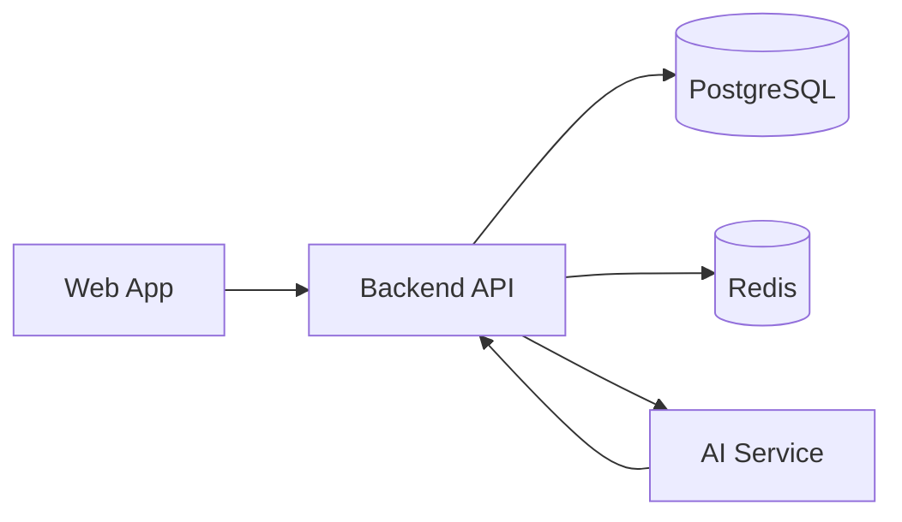

# LocalAI Architecture

## Runtime Components
- Frontend (`apps/web`): role-based merchant/customer demo UI.
- Backend (`apps/backend`): commerce APIs and action validation.
- AI Service (`apps/ai-service`): intent responses + recommendation engine stubs.
- PostgreSQL (`infra/db/schema.sql`): transactional commerce data.
- Redis (docker-compose): reserved for caching and async jobs in next phase.

## Architecture Diagram

## Voice-to-Action Path
1. User speaks or types intent in app.
2. Intent sent to backend assistant endpoint.
3. Backend/AI decides tool suggestions.
4. Backend executes authorized workflow.
5. Result returned as text + UI state update.

## Security Baselines in this Scaffold
- Input validation via Zod/Pydantic.
- No direct payment trust from client-side callbacks.
- Separate order and payment states.
- Placeholder action policies for approval-required operations.

## Next Build Layer
- Add JWT auth middleware.
- Add role-based permissions in route guards.
- Replace in-memory backend store with SQL repositories.
- Add webhook signature verification.
- Add inventory hold expiry worker.
